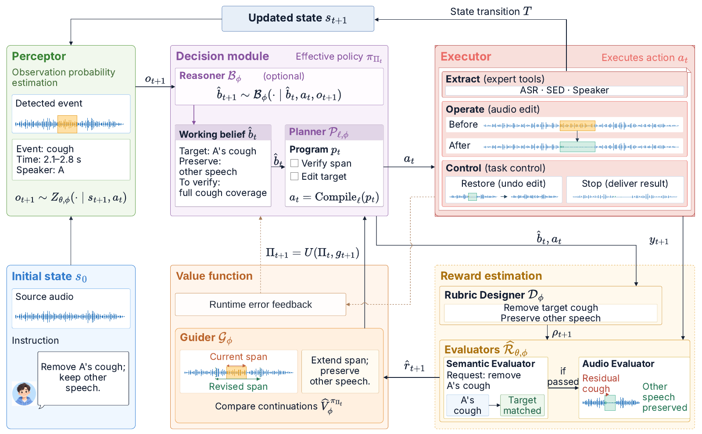

# X·Edit
### Natural-language speech editing with specialist tools

[Quick start](#quick-start) · [Framework](#framework) · [Deployment](docs/MODULE_DEPLOYMENT.md) · [Tools](docs/TOOL_SELECTION.md) · [License](#license)

X·Edit turns a speech-editing request into an executable sequence of tool calls.
It combines audio perception, reasoning, planning, execution, and optional
evaluation-driven revision.

> “Replace ‘tomorrow’ with ‘Friday’, make the last sentence happier, and keep the speaker.”

The framework decides which operations to run and tracks their inputs and outputs.
Available edits depend on the tools you deploy and enable.

## Framework



*Framework figure from the accompanying manuscript. [Figure provenance](docs/assets/README.md).*

- **Perceive:** transcribe the audio and collect evidence about speakers and sounds.
- **Plan:** interpret the request, choose enabled tools, and order the edits.
- **Execute:** validate each operation, call its service, and save the audio and trace.
- **Revise:** optionally evaluate the result and use feedback to revise the plan.

**Forward mode** makes one planning/execution attempt, with the Reasoner enabled
by default. **Revision mode** adds evaluation and revision, with up to three
attempts by default. Errors remain visible; a failed backend is not silently
replaced by another one.

## Choose an editing backend

| Backend | How it edits speech | Setup |
| --- | --- | --- |
| **dots.tts.edit V1.1** — default | One independently deployed model handles tagged text, emotion, pitch, rate, and pause edits. | [Model setup](docs/DOTS_TTS_EDIT.md) |
| **dots.tts.edit Data Pipeline** | Separate services perform alignment, synthesis, local editing, and assembly. | [Pipeline setup](docs/PIPELINE.md) |

Both use the same tool inputs. Switch `edit_backend` in `configs/tools.yaml`;
the compatible tool name remains `edit_data_pipeline`. The two backends do not
promise identical audio, timing, or quality.

The pipeline links to the public
[studio-dots-ai/dots.tts.edit-data-pipeline](https://github.com/studio-dots-ai/dots.tts.edit-data-pipeline)
repository. Code and model revisions are pinned; installation does not follow a
moving branch.

## Quick start

Required: Linux, Git, Python 3.11.15, uv 0.11.28, FFmpeg/ffprobe, and libsndfile.
Model services need compatible hardware and separately obtained weights.
The full tool stack is not a single-GPU deployment.

### 1. Install the controller

```bash
git clone https://github.com/bovod-sjtu/X-EDIT.git
cd X-EDIT
python3 -m pip install uv==0.11.28
uv python install 3.11.15
UV_PROJECT_ENVIRONMENT="$PWD/.venv" uv sync --locked --no-dev
cp .env.example .env
```

This installs the controller, not model services. Do not use a recursive clone:
external tools have separate installation and license requirements.

### 2. Select the tools you have deployed

The starting configuration in `configs/tools.yaml` is:

```yaml
schema_version: x-edit.tools/v1
edit_backend: dots_tts_edit
enabled_tools:
  - artifact_ops
  - edit_data_pipeline
  - asr
  - aligner
  - omni
```

Deploy the selected services and set their URLs and model names in `.env`.
Start with the [model guide](docs/DOTS_TTS_EDIT.md) or
[pipeline guide](docs/PIPELINE.md). Remove unavailable tools; add optional tools
from `configs/tools.full.yaml` only after deploying them. The Reasoner and Planner
see only the enabled capabilities, and the executor enforces the same selection.

Install the selected MCP clients:

```bash
.venv/bin/python deployment/client_envs.py \
  --tools configs/tools.yaml --env-root /data/xedit/envs/clients
```

Set `X_EDITOR_MCP_ENV_ROOT=/data/xedit/envs/clients` in `.env`.
Each client and each managed service has its own uv environment.
Preinstalled clients are not automatically synchronized during execution.

### 3. Check the deployment and edit audio

```bash
.venv/bin/x-edit --env-file .env doctor --config configs/runtime.yaml
.venv/bin/x-edit --env-file .env doctor --config configs/runtime.yaml --live

.venv/bin/x-edit --env-file .env edit --config configs/runtime.yaml \
  --audio /data/audio/source.wav \
  --instruction "Make this sentence sound happier. Keep the words and speaker." \
  --mode forward --output /data/xedit/runs/first-edit
```

Use a new output directory for each run. `result.json` identifies the selected
audio and execution records; a failed delivery returns a nonzero exit status.
`doctor --live` checks connections and interfaces, not editing quality.

Use `--mode revision` after configuring evaluation endpoints. See the
[runtime API](docs/RUNTIME.md) for Python, multi-audio, and multi-turn usage.

## Deployment and repository layout

The controller, MCP clients, and model services are separate environments.
Reasoner, Planner, perception, and evaluation can use separate inference
endpoints or share compatible ones. The workflow itself runs in the controller.

Keep model files, reference recordings, logs, and generated audio **outside this
repository**. Across hosts, path-based services need the same absolute audio
paths on shared storage. Put remote endpoints behind access control; the example
services are not public multi-tenant servers.

```text
x_editor/       Framework, prompts, capability cards, and original adapters
configs/        Runtime and tool selections
deployment/     Environment setup, service orchestration, and checks
third_party/    Upstream links, revision pins, and license records
docs/           Setup guides, interfaces, and the framework figure
```

The package is `x-edit-audio`, the CLI is `x-edit`, and the Python namespace is
`x_editor`. A wheel installs the controller; use the source checkout for service
deployment. Run `x-edit init ./configs` to export packaged configurations.

## Documentation and validation

| Guide | Contents |
| --- | --- |
| [Module deployment](docs/MODULE_DEPLOYMENT.md) | Separate uv environments, remote services, and role endpoints |
| [Deployment reference](docs/DEPLOYMENT.md) | System dependencies, service startup, and operation checks |
| [Tool selection](docs/TOOL_SELECTION.md) | Enable capabilities and switch editing backends |
| [Service capabilities](docs/SERVICE_CAPABILITIES.md) | Prerequisites for each tool |
| [Tool contracts](docs/TOOL_CONTRACTS.md) | Parameters, audio assets, and errors |
| [Validation](docs/VALIDATION.md) | What this release was actually tested on |
| [Reproducibility](docs/REPRODUCIBILITY.md) | Version records and evaluation boundaries |

Deployment checks, valid waveforms, and benchmark scores are different evidence.
Historical scores apply to their recorded code, models, and settings—not
automatically to the current release.

## License

Original code, configuration, and documentation that X·Edit is entitled to
license use [Apache-2.0](LICENSE). Third-party code, weights, data, and outputs
retain their own terms. This repository does not bundle third-party model
implementations, weights, datasets, reference recordings, or generated audio.

- **F5-TTS:** operator-installed and disabled by default. No automatic download or
  installation. Its recorded SDK is MIT; the recorded official
  `F5TTS_v1_Base` weights are CC-BY-NC-4.0. See [external tools](docs/EXTERNAL_TOOLS.md).
- **SAM-Audio and VoiceSculptor-VD:** not in the built-in toolset or deployment
  code. Only [extension guidance](docs/EXTENSION_GUIDE.md) is provided.
- **FFmpeg:** used as an external program; no binary is bundled. The supplied
  build disables GPL and nonfree features.

Independent installation, a submodule, or HTTP access does not remove model-use
restrictions or grant commercial rights. Service operators remain responsible
for their deployments. Review containers and binary packages separately.
See [third-party notices](third_party/NOTICE.md), the
[license inventory](docs/LICENSES.md), and the [release boundary](docs/RELEASE_SCOPE.md).

## Acknowledgments

X·Edit builds on [dots.tts](https://github.com/studio-dots-ai/dots.tts),
[dots.tts.edit Data Pipeline](https://github.com/studio-dots-ai/dots.tts.edit-data-pipeline),
and the specialist tools listed in the third-party inventory. Upstream
implementations and contributor work retain their attribution and licenses.
